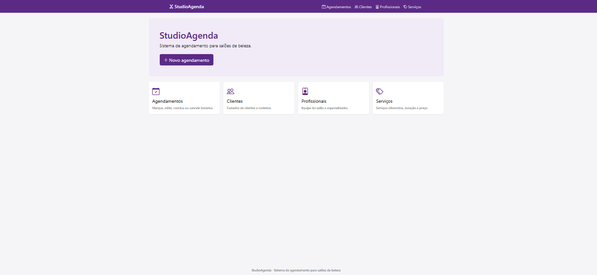
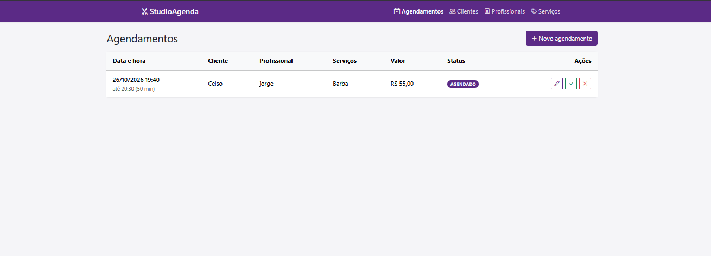
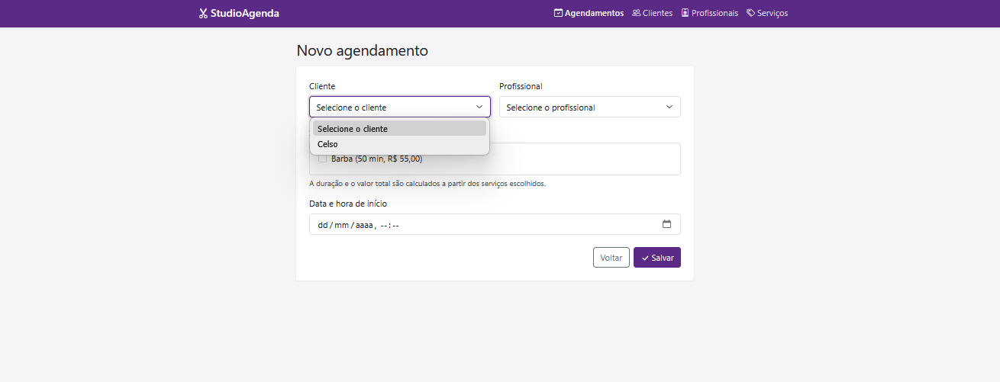
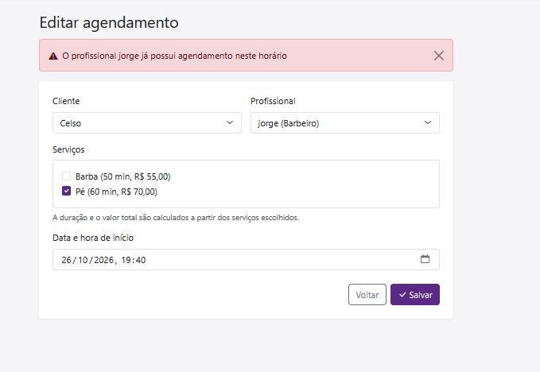
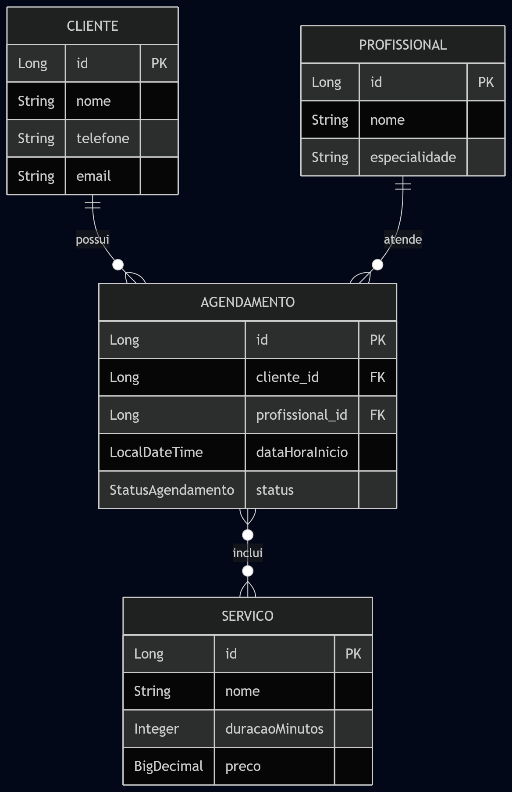

# StudioAgenda

Sistema web de agendamento para salões de beleza e barbearias. A recepção cadastra clientes,
profissionais e serviços e marca horários com um ou mais serviços. O sistema calcula sozinho
a duração e o valor total e impede que um profissional tenha dois atendimentos no mesmo horário.

## Funcionalidades

- Cadastro de **clientes**, **profissionais** e **serviços** (criar, listar, editar e excluir)
- **Agendamentos** com cliente, profissional, um ou mais serviços e data/hora de início
- Cálculo automático do **horário de término** e do **valor total** a partir dos serviços escolhidos
- **Bloqueio de conflito de horário**: um profissional não pode ter dois agendamentos sobrepostos
- Controle de status: `AGENDADO` → `CONCLUIDO` ou `CANCELADO`
- Interface responsiva com Bootstrap 5, que funciona no computador e no celular

## Regras de negócio

| Regra | Comportamento |
|---|---|
| Conflito de horário | Dois agendamentos do mesmo profissional não podem se sobrepor. Horários que apenas encostam (10:00–11:00 e 11:00–12:00) são permitidos |
| Agendamentos cancelados | Liberam o horário: não contam na verificação de conflito |
| Alteração de status | Só agendamentos `AGENDADO` podem ser editados, concluídos ou cancelados |
| Data do agendamento | Precisa estar no futuro |
| Exclusão de cadastros | Clientes, profissionais e serviços vinculados a algum agendamento não podem ser excluídos |

## Telas

| Início | Agendamentos |
|---|---|
|  |  |

| Novo agendamento | Conflito de horário |
|---|---|
|  |  |

## Modelagem de dados



`Agendamento` se relaciona com `Cliente` e `Profissional` via `@ManyToOne` e com `Servico`
via `@ManyToMany`, já que um agendamento pode incluir vários serviços (ex.: corte + escova)
no mesmo horário.

## Arquitetura

O projeto segue a divisão em camadas do Spring:

```
Controller (Thymeleaf)  →  Service (regras de negócio)  →  Repository (Spring Data JPA)  →  Banco
        ↑                          ↑
       DTOs (records com Bean Validation)
```

- **controller**: recebe as requisições, valida os formulários e escolhe a tela
- **service**: regras de negócio (cálculo de horário, conflito, status, exclusão) e transações
- **repository**: acesso a dados, incluindo a query JPQL de detecção de conflito
- **dto**: objetos de entrada e saída das telas, separados das entidades JPA
- **exception**: exceções de negócio, tratadas na tela ou pelo `GlobalExceptionHandler`

O banco é versionado com **Flyway** (`src/main/resources/db/migration`). O Hibernate só
valida o schema (`ddl-auto: validate`) e não cria tabelas.

## Tecnologias

- **Java 21**
- **Spring Boot 4.1** (Web MVC, Data JPA, Validation, Thymeleaf)
- **Hibernate** / Spring Data JPA
- **Flyway** (migrations do banco)
- **Thymeleaf** + **Bootstrap 5** + Bootstrap Icons
- **H2** (desenvolvimento e testes) / **PostgreSQL** (produção)
- **Lombok**
- **JUnit 5**, **Mockito** e **AssertJ** (testes)
- **Gradle**

## Estrutura do projeto

```
studio-agenda/
├── build.gradle
├── docs/
│   ├── imagens/              diagrama ER
│   └── screenshots/          prints das telas
└── src/
    ├── main/
    │   ├── java/com/salao/studioagenda/
    │   │   ├── controller/   controllers MVC e tratamento de erros
    │   │   ├── dto/          records de request/response
    │   │   ├── exception/    exceções de negócio
    │   │   ├── model/        entidades JPA
    │   │   ├── repository/   repositórios Spring Data
    │   │   └── service/      regras de negócio
    │   └── resources/
    │       ├── db/migration/ scripts Flyway
    │       ├── templates/    telas Thymeleaf
    │       └── application.yml
    └── test/java/com/salao/studioagenda/
        ├── controller/       testes de integração das telas (MockMvc)
        ├── repository/       testes da query de conflito (@DataJpaTest)
        └── service/          testes unitários (Mockito)
```

## Como executar

Pré-requisito: **JDK 21**. O Gradle é baixado pelo wrapper.

```bash
./gradlew bootRun
```

No Windows (PowerShell), use `.\gradlew bootRun`.

Acesse **http://localhost:8080**. Por padrão o sistema usa o perfil `dev`, com banco H2 em memória:
os dados são perdidos ao reiniciar.

Para consultar o banco durante o desenvolvimento, use o console do H2 em
**http://localhost:8080/h2-console**:

| Campo | Valor |
|---|---|
| JDBC URL | `jdbc:h2:mem:studioagenda` |
| User Name | `sa` |
| Password | *(em branco)* |

### Produção (PostgreSQL)

Defina as variáveis de ambiente e ative o perfil `prod`. O Flyway cria as tabelas na primeira execução.

```bash
export DATABASE_URL=jdbc:postgresql://localhost:5432/studioagenda
export DATABASE_USERNAME=usuario
export DATABASE_PASSWORD=senha
./gradlew bootRun --args='--spring.profiles.active=prod'
```

## Testes

```bash
./gradlew test
```

São 58 testes automatizados:

| Tipo | O que cobre |
|---|---|
| Unitários (Mockito) | Services: cálculo de horário e valor, conflito, mudança de status e bloqueio de exclusão |
| Repositório (`@DataJpaTest`) | Query de conflito no banco: sobreposição, horários que só encostam, outro profissional, cancelados e edição |
| Integração (MockMvc) | Telas: cadastro, validação de formulário, conflito, edição, cancelamento, conclusão e carregamento de todas as páginas |

## Roadmap de desenvolvimento

- [x] Sprint 1: Modelagem com entidades JPA e configuração multi-profile
- [x] Sprint 2: Repositories (Spring Data JPA) e query de conflito de horário
- [x] Sprint 3: DTOs e camada de Service com as regras de negócio
- [x] Sprint 4: Controllers CRUD e telas de Cliente, Profissional e Serviço
- [x] Sprint 5: Tela de Agendamento
- [x] Sprint 6: Layout com Bootstrap 5, testes e migrations com Flyway

### Próximos passos

- Login com Spring Security para os funcionários do salão
- Agenda do dia por profissional, em visão de calendário
- Área de autoagendamento para o cliente final

## Autor

**João Vitor Santos de Souza**: [github.com/joaoSouza00](https://github.com/joaoSouza00)
